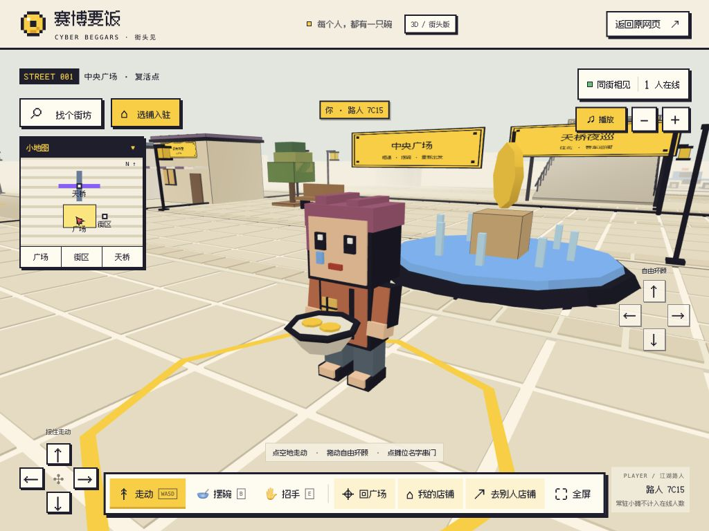
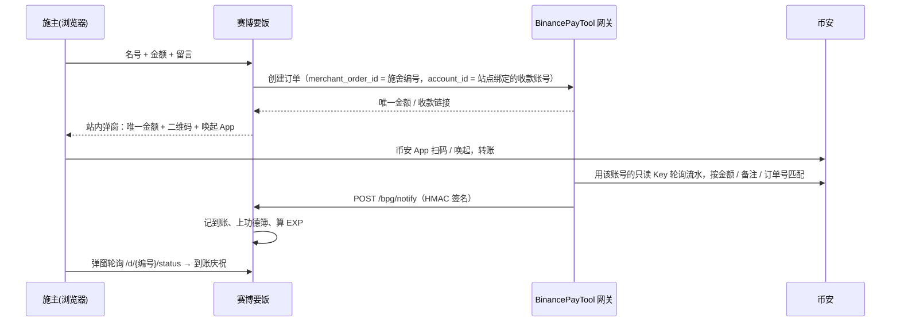

<div align="center">

# 🥣 赛博要饭 · newbeggar

**一个能「要饭」的像素风网站：摆碗、投币、留言、开分舵，还能进入 3D 多人街区，和大家见面、入驻店铺、一起躲警车。**

[](go.mod)
[](#3d-多人街区)
[](LICENSE)
[](https://github.com/qianyubtc/BinancePayTool)
[](#技术栈)
[](https://newbeggar.com)
[](https://qianyuwing.com)
[](https://github.com/qianyubtc/newbeggar/stargazers)

**在线体验：<https://newbeggar.com>** —— 作者本人的碗。投个币、丢个钢镚，或者发条推开你自己的分舵试试。

**3D 街区：[中央广场](https://newbeggar.com/world)** · 多人同场景 / 选铺入驻 / 天桥夜巡

作者主页 <https://qianyuwing.com> · [𝕏 @qianyuwing](https://x.com/qianyuwing)

</div>

---

## 目录

- [它是什么](#它是什么)
- [特性](#特性)
- [3D 多人街区](#3d-多人街区)
  - [进入与操作](#进入与操作)
  - [入驻店铺与串门](#入驻店铺与串门)
  - [天桥夜训怎么玩](#天桥夜训怎么玩)
  - [自己部署时启用](#自己部署时启用)
  - [性能与当前边界](#性能与当前边界)
- [工作原理](#工作原理)
- [快速开始](#快速开始)
  - [1. 起一个收款网关](#1-起一个收款网关)
  - [2. 币安 API Key 怎么配](#2-币安-api-key-怎么配)
  - [3. 配置并运行本站](#3-配置并运行本站)
- [配置项参考](#配置项参考)
- [部署到服务器](#部署到服务器)
- [玩法规则](#玩法规则)
- [页面与接口](#页面与接口)
- [安全边界](#安全边界)
- [开发与测试](#开发与测试)
- [常见问题](#常见问题)
- [技术栈](#技术栈)
- [支持本项目](#支持本项目)
- [License](#license)

## 它是什么

- **主站**是站长的碗。施主填个名号、选个金额、留一句话，**不离开本站**：弹窗里出现唯一金额、收款二维码、一键唤起币安 App，页面自动轮询，到账后当场庆祝并刻上功德簿。
- **分舵**：任何人用 X 账号发一条带验证码的推文，就能开自己的要饭站 `域名/X用户名`，钱直接进他自己的币安账户。不用先施舍，不用注册，一个 X 账号一个站。
- **钢镚**：不想花钱也能玩。每人每站每天免费丢一个钢镚，有硬币飞进碗里的动画，但**不能留言**（只有真钱才能留言，堵住广告）。
- **丐帮**：钱和钢镚折成 EXP，升「一袋弟子 … 九袋长老」；全站按 EXP 排名，第一名是帮主，掉出名次自动易主。
- **3D 多人街区**：从中央广场出发，在延伸街道里遇到真人、打招呼、碰碗、挑铺开店，或去天桥一起躲警车；保留全部原网页入口。
- **像素游戏风**：端碗的像素小人吉祥物、RPG 对话框、INSERT COIN 投币面板、街机 HIGH SCORE 榜、8-bit 音效。手机优先。

**钱不经过本站。** 收款走开源网关 [BinancePayTool](https://github.com/qianyubtc/BinancePayTool)：用币安官方**只读** API 轮询你自己账户的流水做匹配，本站和网关都拿不走一分钱。

## 特性

| 模块 | 说明 |
|---|---|
| 站内付款 | 弹窗内完成：唯一金额 + 二维码 + 唤起币安 App + 自动轮询；没自动确认可回填币安订单编号，本站代转网关核对 |
| 双榜 + 周榜 | 施主榜（给当前站长投币最多的人）、乞丐榜（所有站按要到的钱排）、人气榜（按钢镚排）；总榜 / 本周切换 |
| 分舵开站 | X 发推验证：路径 = X 用户名，站名锁定 X 昵称，头像用 X 头像，验证码绑定发起的浏览器；忘口令再发推找回（按 X 数字 ID 认人，改过用户名也找得回） |
| 子站收款 | 十秒上手：填自己的币安 UID（施主在币安 App 按 UID 转账，转完自报，站长确认）；进阶：绑定币安**只读** API Key，注册到网关成独立账号，到账自动上榜 |
| 施主 X 身份 | 投币时可填自己的 X，功德簿和榜单显示 X 头像和 @名，同一 X 合并计榜 |
| 反垃圾 | 留言 / 名号 / 口号过滤网址、微信、QQ、TG、手机号；站长可屏蔽留言（显示 `***`）或屏蔽此人；可选「新站待收录」模式 |
| 徽章与回复 | 🏁 首位施主 💎 单笔最大 🔥 常客；站长可回复留言；感谢页一键生成像素分享卡 |
| 3D 多人街区 | Three.js + Go WebSocket，近距离第三人称、自由环顾、中央广场、延伸地图、小地图、手机摇杆与快捷传送 |
| 店铺与互动 | 免费选铺入驻、昵称招牌、主页直达店铺、搜索串门；真人打招呼、碰碗和固定短语同步 |
| 天桥夜巡 | 六处藏身点、四步新手引导、服务端倒计时、警车巡查、被抓回广场和上局回放，与原版共用钢镚和结算 |
| 声音 | 8-bit 音效由 Web Audio 现场合成，不加载音频文件；背景音乐可选（放一个 `static/bgm.m4a` 即可）；喇叭一键静音 |
| 后台 | 改资料、设收款、确认 / 拒绝手动施舍、屏蔽、回复、改口令（弹窗）；主站站长额外可巡查全站留言、除名违规子站、帮站长重置口令 |
| 多语言 | 中文原文即 key，按语言查表：中 / 英 / 日 / 韩 / 俄 / 西 / 葡 / 法 / 德 / 越 / 印尼 / 土 12 种；按浏览器语言自动选，导航栏 🌐 可切换（记 cookie）；查不到的回落英文再回落中文 |
| 部署 | 单二进制、SQLite（无 CGO）、模板与字体全部内嵌；交叉编译扔到任何 Linux 上就能跑 |

## 3D 多人街区

**[直接进入 3D 街头 →](https://newbeggar.com/world)**

在原有像素网页之外，增加一个由 Three.js 渲染的多人街区。大家从中央广场相遇，端着碗逛街、和路人碰碗、去朋友的店铺串门，也能到天桥参加夜巡。原来的个人主页、收款、排行榜和后台继续使用。



### 街区里能做什么

| 区域 / 功能 | 玩法 |
|---|---|
| 中央广场 | 普通入口的共同出生点，有金币喷泉、树木、长椅和通往大街、天桥的路牌；被抓后也回到这里 |
| 真实多人 | 通过 WebSocket 同步真人的位置、朝向和动作，可以互相看到走动、摆碗、招手 |
| 延伸街区 | 边走边生成街道、店铺、庭院和长椅，附近加载、远处回收；真实站点的店铺各有唯一位置 |
| 选铺入驻 | 已收录的站长可以免费选择空铺，招牌使用本人昵称，位置保存到数据库，一人一铺 |
| 见面互动 | 靠近其他玩家后点击角色 / 名字或按 F，打招呼、碰碗、发送固定短语；双方看到动作和回应 |
| 天桥夜巡 | 六处藏身点、玩法引导、锁门倒计时、真实结算、警车巡查和上局回放，与原版夜巡共用规则和钢镚 |
| 小地图与传送 | 显示自己的朝向、在线角色和地标；可回广场、回自己店铺，也可搜索并传送到别人店铺 |
| 音乐与手机控制 | 复用原站背景音乐和静音偏好；横屏提示、左手摇杆、右手环顾、缩放和全屏入口 |

在线人数按实际 WebSocket 连接计算，同一个人打开多个窗口会分别计数。常驻店主形象和夜巡 NPC 不计入在线人数；公共装饰店铺也不会生成虚构账号。

### 进入与操作

首页有醒目的「进入 3D 街区」入口，导航栏也可进入。个人主页的「去 TA 的 3D 店铺」会直接到店门口，登录后显示「进入我的 3D 店铺」。也可以使用 `/world?site=X用户名` 分享店铺直达链接；主站使用 `/world?site=`。

| 操作 | 电脑 | 手机 |
|---|---|---|
| 走动 | WASD / 方向键，或点击空地寻路；画面上也有方向按钮 | 左手拖动摇杆控制方向和速度，松手即停；也可点击空地 |
| 上下左右看 | 拖动画面自由环顾，或使用右侧环顾按钮 | 右手滑动画面，或点击环顾按钮 |
| 拉近 / 拉远 | 滚轮或右上角 ＋ / − | 双指缩放或右上角 ＋ / − |
| 摆碗 / 招手 | B / E，或底部按钮 | 底部「摆碗」「招手」按钮 |
| 与玩家互动 | 点击角色 / 名字、附近互动提示，或按 F | 点击角色 / 名字或附近互动提示 |
| 快捷传送 | 底部「回广场」「我的店铺」「去别人店铺」，或小地图地标按钮 | 同左 |

镜头默认采用近距离第三人称视角，移动方向随镜头朝向变化。黄色落点标记表示寻路目的地，角色会绕开房屋。手机推荐横屏，首次竖屏进入会提示旋转，也可以选择继续竖屏；全屏和方向锁定取决于浏览器支持。

### 入驻店铺与串门

1. 登录自己的站长账号。子站须先被主站收录，才会出现在街区并获得入驻资格；游客可以先逛街。
2. 点击「选铺入驻」，或街上的黄色「空铺待入驻」招牌，选择空铺并先到门口看看。
3. 点击「入驻这里」，店铺使用本站昵称作为招牌。位置会保存，刷新、重连或服务器重启后保留；换铺会释放旧铺位。
4. 用「我的店铺」随时回家；用「去别人店铺」搜索昵称 / X 用户名，点击店主直接到门口。对方换铺后，串门入口跟随最新位置。

未选铺的已收录站点也有默认店铺。公共广场、天桥和庭院不能入驻，同一铺位只能有一位站长。点摊主或摊位名字可查看资料、免费丢钢镚，或回原网页施舍；钢镚仍受原有每日限制，投币事件会同步到街区。

### 天桥夜训怎么玩

夜训是原「城管夜巡」的 3D 入口，使用站内免费钢镚，不发起币安支付。游客可围观，登录站长账号后可参加。六处藏身点为：**桥洞、破庙、天桥底、公园长椅、地铁通道、烂尾楼**。

1. 从小地图点「天桥」，或从广场向北走。首次进入会显示四步引导，「怎么玩？」可随时重看；全景入口可以查看六处地点。
2. 点编号招牌或面板选择藏身点，填写本局钢镚数量，点击「确认藏好」。只走到建筑旁、只选中地点都还没有参加。
3. 关注按服务端时间校准的锁门倒计时，最后 10 秒有提醒。锁门前可调整地点、数量或撤出；角色走动不会改变已确认地点。橙色表示预选，金色表示已确认。
4. 锁门后等待警车巡查。被查封地点的参与者失去本局钢镚，被抓角色停留 8 秒后回广场；幸存者返还本金并按规则参与分成。若不足两处有人则退回，新局需要重新选择并确认。

结果会区分围观、被抓、幸存和流局。「上一局回放」只重播抓捕效果，不重复结算。离线参与者和 NPC 也会显示在夜巡场景中，并明确标为「夜巡」。

### 自己部署时启用

在现有 `config.env` 中设置后重启本站：

```dotenv
WORLD_ENABLED=true
RAID_ENABLED=true
```

`WORLD_ENABLED` 默认 `false`，开启后显示 3D 入口并启用相关路由。`RAID_ENABLED` 控制夜巡玩法，可独立关闭，其他街区功能照常使用。无需为 3D 单独启动服务，也无需配置收款网关才能逛街；前端产物随 Go 程序内嵌，普通部署只需构建一个二进制。

反向代理需要支持 `/world/live` 的 WebSocket 连接，网页、API 和 WebSocket 使用同一个站点域名。仓库提供的 [Caddy 片段](deploy/Caddyfile)可用于此模块；反代后的真实 IP 配置继续使用 `TRUST_PROXY` / `TRUST_PROXY_HEADER`，以便连接限流正确区分访客。

背景音乐是可选资源：将自己的 AAC 音乐放入 `static/bgm.m4a` **再构建**，仓库不附带音频。首次点击 / 触摸后播放，右上角可关闭，切后台或离开时暂停；没有文件则不显示音乐开关。

### 性能与当前边界

- 街区按 48×48 单位分块，只保留周围 9 块地面；远处景物、招牌贴图和自有几何会回收。静态模型按材质合并绘制，移动端限制像素比、关闭抗锯齿并限制为最高 30 FPS，隐藏页面暂停绘制。
- 前端资源使用内容哈希、gzip、永久缓存和 ETag / 304；字体与站点资料并行加载。服务端模拟移动 20 Hz，状态最多 10 Hz 广播，静止时保留每秒心跳。
- 当前为**单进程内存房间**：最多 64 个连接、每个签名访客最多 4 个窗口、每 IP 最多 12 个连接。这些是保护上限，并非已验证的满员流畅度承诺；多实例部署暂不能共享同一个房间。
- 角色位置不持久化，刷新或重连会重新入场；店铺位置保存在 SQLite `world_shops`。每次注册表刷新最多载入 2,000 个公开营业站点（主站及已收录子站），停用、迁移或除名的站点不继续占用公开铺位。
- 地图有 ±1,000,000 的坐标保护范围。互动目前使用固定动作和短语，暂不支持自由文字聊天；新模块界面暂为中文。3D 需要浏览器具备 WebGL 能力，原网页仍可单独使用；低端手机 GPU、真机多指和系统方向锁的表现需按设备验证。

## 工作原理



回调丢了也不怕：轮询时本站每 4 秒主动向网关查一次单。少付（网关 `underpaid`）按实付计入——要饭嘛，给多少是多少。

## 快速开始

### 1. 起一个收款网关

本站依赖 [BinancePayTool](https://github.com/qianyubtc/BinancePayTool)（需为**支持多账号**的版本，2026-09 之后的 main 都是）。按它的 README 跑起来，记下两样东西：

- 网关地址，比如 `http://127.0.0.1:8123`（与本站同机时用内网地址即可）
- 网关的 `API_AUTH_KEY`（网关 `./bpaygate -gen-key` 生成）

> 不想接网关也能跑：`BPG_URL` 留空，填 `MAIN_RECEIVE_LINK` / `MAIN_PAY_ID`，主站按「直接转账」模式工作（施主自报、站长后台确认）。此时子站也只能直接转账。

### 2. 币安 API Key 怎么配

本站**不需要**你的 API Key，Key 只给网关。两个层面：

**主站（站长自己）**：在网关的 `config.env` 里填 `BINANCE_API_KEY` / `BINANCE_API_SECRET` / `BINANCE_UID`，这是网关的默认收款账号，主站的所有订单都走它。

**子站（分舵站长）**：他们在本站后台「收款方式 → 绑定币安 API Key」里填自己的 Key、Secret、UID。本站把它注册到网关，网关加密保存并为这个账号单独轮询流水；**Key 不落本站数据库，任何页面都不展示**。

创建 Key 的步骤（币安 App）：

1. 账户 → API 管理 → 创建 API → 选「系统生成」。
2. 权限**只勾「允许读取」**（默认就是），不要开现货交易、提现、合约等任何写权限。
3. IP 白名单：主站的 Key 建议限制为网关服务器的出口 IP；分舵站长的 Key 可以不限（只读 Key 拿不走钱）。
4. 币安 UID 在 App 头像页能看到。

**最简单的收款方式不需要 Key**：分舵站长在后台填自己的**币安 UID**（App 左上角头像下面那串数字）就能收钱——施主在币安 App「支付 → 转账」里输入 UID 转账，转完自报，站长确认后上榜。绑定只读 Key 是进阶选项，好处是到账自动确认、自动上榜。

> 网关与本站都**永不发起转账**。想退款只能在币安 App 里手动转回，流水里有付款方信息。

### 3. 配置并运行本站

```bash
git clone https://github.com/qianyubtc/newbeggar.git && cd newbeggar
go build -o beggar .
cp config.example.env config.env
./beggar -gen-key                 # 生成一个随机口令，填到 config.env 的 ADMIN_PASSWORD
# 编辑 config.env：BASE_URL、BPG_URL、BPG_KEY、MAIN_NAME、MAIN_X …
./beggar -config config.env
```

打开 `BASE_URL/` 就是你的碗；`BASE_URL/login`（X 用户名留空 + `ADMIN_PASSWORD`）进主站后台。登录后可以在后台改口令，`ADMIN_PASSWORD` 只在首次建站或 config 里的值变化时才覆盖。

## 配置项参考

复制 [config.example.env](config.example.env) 为 `config.env`，同名环境变量优先于文件。

| 分组 | 键 | 默认 | 说明 |
|---|---|---|---|
| 基础 | `LISTEN` | `127.0.0.1:8124` | 监听地址 |
| | `BASE_URL` | — | 对外地址，回调、子站链接、推文里的链接都用它拼 |
| | `SITE_TITLE` | `赛博要饭` | 站名 |
| | `ADMIN_PASSWORD` | — | 主站站长口令，`./beggar -gen-key` 生成 |
| | `AUTHOR_GITHUB` / `AUTHOR_X` | 作者链接 | 页脚作者链接，留空不显示，**部署时改成你自己的** |
| 主站资料 | `MAIN_NAME` / `MAIN_SLOGAN` / `MAIN_AVATAR` | — | 首次启动写入库，之后在后台改 |
| | `MAIN_X` | — | 主站绑定的 X（`@名字` 或主页链接），头像会自动从 X 抓 |
| 收款 | `BPG_URL` / `BPG_KEY` | — | 网关地址与其 `API_AUTH_KEY`；留空则主站走直接转账 |
| | `MAIN_RECEIVE_LINK` / `MAIN_PAY_ID` | — | 直接转账模式用的收款码链接 / Pay ID |
| 施舍 | `CURRENCY` | `USDT` | 币种 |
| | `PRESET_AMOUNTS` | `0.1,1` | 金额档位，页面再加一个「自定义」 |
| | `MIN_AMOUNT` / `MAX_AMOUNT` | `0.1` / `10000` | 上下限 |
| | `ORDER_TTL` | `900` | 网关订单有效期（秒） |
| 子站 | `SUBSITES_ENABLED` | `true` | 是否开放开站 |
| | `SUBSITE_REVIEW` | `true` | 新站默认「未收录」（不进榜、noindex），主站站长后台收录。防广告站蹭曝光 |
| 钢镚 | `COINS_PER_DAY` / `COINS_IP_CAP` / `COINS_IP_TOTAL` | `1` / `3` / `30` | 每人每站每天几个；每 IP 每站每天上限；每 IP 每天全站总上限（0 不限）|
| 经验 | `MONEY_EXP` / `COIN_EXP` | `10` / `1` | EXP = 钱(U) × MONEY_EXP + 钢镚 × COIN_EXP |
| 3D 街区 | `WORLD_ENABLED` | `false` | 启用 3D 入口、街区 API 与多人 WebSocket；改配置后重启 |
| 夜巡 | `RAID_ENABLED` | `true` | 原版 / 3D 夜巡共用开关，关闭后仍可逛街 |
| | `RAID_ROUND_SEC` / `RAID_MAX_BET` | `600` / `50` | 每局秒数 / 每人每局钢镚上限 |
| | `RAID_RAKE_PCT` / `RAID_BOTS` | `5` / `6` | 没收钢镚转入下一局奖池的百分比 / NPC 数量，NPC 设 0 可关闭 |
| X | `X_TWEET_API` / `X_AVATAR_API` | 公开接口 | 读推文与头像的接口，一般不用改；测试时指向 mock |
| | `AVATAR_DIR` | `./avatars` | 头像缓存目录 |
| 反代 | `TRUST_PROXY` | `true` | 在反向代理后面时开启，限流按真实访客 IP |
| | `TRUST_PROXY_HEADER` | `X-Forwarded-For` | 直接反代用默认值；前面有 Cloudflare 填 `CF-Connecting-IP` |
| 存储 | `DB_PATH` | `./beggar.db` | SQLite 文件 |

## 部署到服务器

```bash
# 本机交叉编译（无 CGO，静态二进制）
GOOS=linux GOARCH=amd64 CGO_ENABLED=0 go build -trimpath -buildvcs=false -ldflags="-s -w" -o beggar-linux-amd64 .

# 服务器
sudo useradd -r -s /usr/sbin/nologin beggar && sudo mkdir -p /opt/beggar && sudo chown beggar:beggar /opt/beggar
sudo install -o beggar -g beggar -m 755 beggar-linux-amd64 /opt/beggar/beggar
sudo -u beggar cp config.example.env /opt/beggar/config.env && sudo chmod 600 /opt/beggar/config.env   # 填好
sudo cp deploy/beggar.service /etc/systemd/system/ && sudo systemctl enable --now beggar
```

- 反向代理片段见 [deploy/Caddyfile](deploy/Caddyfile)。
- 放在 **Cloudflare 橙色云朵**后面：再加一个不跳转的 `http://域名` 块（兼容 Flexible 模式），`TRUST_PROXY_HEADER=CF-Connecting-IP`，并建议防火墙只放行 Cloudflare 回源 IP。
- 与网关同机时 `BPG_URL` 填内网地址；回调地址 `BASE_URL/bpg/notify` 必须能被网关访问到。
- **更新**：编译新二进制，`sudo install` 覆盖后 `sudo systemctl restart beggar`，中断一两秒，库不动。
- **上线前清掉测试数据**：`sudo bash deploy/reset-data.sh`。先备份库，只保留主站资料、口令和会话密钥。

## 玩法规则

**EXP** = 碗里的钱(U) × 10 + 钢镚 × 1（默认，可配）。0.1 U 或 1 个钢镚都是 1 EXP。

**袋位**看自己的 EXP，不受别人影响：

| 空碗未入帮 | 一袋 | 二袋 | 三袋 | 四袋 | 五袋 | 六袋 | 七袋 | 八袋 | 九袋长老 |
|---|---|---|---|---|---|---|---|---|---|
| 0 | 1 | 10 | 50 | 200 | 500 | 1000 | 3000 | 10000 | 50000 |

**职位**按已收录子站的 EXP 名次实时授予，掉出名次自动易主；主站固定为「总舵」：

| 第 1 | 第 2 | 第 3 | 第 4 | 第 5 | 第 6 | 7–10 | 11–30 | 31+ |
|---|---|---|---|---|---|---|---|---|
| 帮主 | 副帮主 | 传功长老 | 执法长老 | 掌棒龙头 | 掌钵龙头 | 长老 | 舵主 | 弟子 |

**徽章**：🏁 首位施主 · 💎 单笔最大 · 🔥 常客（3 天以上投过）。**周榜**按周一 0 点（服务器时区）切。

## 页面与接口

| 路径 | 说明 |
|---|---|
| `/` | 主站 |
| `/{x用户名}` | 子站。路径 = 站长 X 用户名小写；撞上保留字自动加 `x_` 前缀 |
| `/rank` | 全站施主榜 / 乞丐榜 / 人气榜 |
| `/new` `/reset` | 用 X 发推验证开站 / 找回口令 |
| `/login` `/manage` | 站长登录（X 用户名 + 口令，主站留空）与后台 |
| `/d/{编号}` | 一笔施舍的状态 / 感谢页（含分享卡） |
| `/pay/{编号}` | 直接转账模式的付款页 |
| `POST /donate` | 发起施舍；带 `ajax=1` 返回弹窗用的付款面板片段 |
| `POST /coin` | 丢钢镚（JSON） |
| `POST /bpg/notify` | 网关回调，`BPG_KEY` 验签 |
| `/world` | 3D 多人街区，须启用 `WORLD_ENABLED` |
| `/world?site={slug}` | 直接到指定站点的 3D 店铺，主站 `slug` 留空 |
| `GET /world/live` | 同源 WebSocket，连接后使用本站签名访客令牌加入，站长身份由会话确定 |
| `GET /api/world/sites` | 已收录营业站点的公开展示资料、店铺位置与玩法配置 |
| `POST /api/world/shop` | 已登录站长选择铺位，一人一铺，服务端校验资格与占用情况 |
| `/raid` / `GET /raid/state` / `POST /raid/bet` | 原版夜巡页面、状态与参加接口，3D 夜巡复用，须启用 `RAID_ENABLED` |
| `/healthz` | 健康检查 |

## 安全边界

- 钱不经过本站：Key 只读、只给网关；子站的 Key **不落本站数据库**，由网关 AES-GCM 加密保存。
- 站长口令 PBKDF2-SHA256；会话是 HMAC 签名 cookie（HttpOnly、SameSite=Lax），改口令即作废所有会话。
- 开站验证码一次性、24 小时有效，且**绑定生成它的浏览器**，别人看到推文里的码也用不了；找回口令按 X 数字 ID 校验，旧用户名被别人注册也接管不了；主站口令不走 X 找回。
- 收款链接只接受 `binance.com`，X 只接受 `x.com` / `twitter.com`。
- 所有 POST 做同源校验，请求体 64 KB 上限，安全响应头齐全；施舍、自报、开站、绑 Key、登录、钢镚均按 IP 限流；反代后只信配置的头且取最后一跳。
- 钢镚防刷：访客标识是本站 HMAC 签名下发的 cookie（脚本自造无效，必须真开过页面），叠加「每人每站每天」「每 IP 每站每天」「每 IP 每天全站总量」三重上限。
- 施主头像抓取有域名白名单、不跟随跳转、先解码校验再落盘，页面只引用本站文件。
- 留言 / 名号 / 口号经 html/template 转义，留言 80 字、名号 20 字。

## 开发与测试

### 本地体验 3D 街区

需要 Go 和 Python 3。启动工具会创建独立的演示数据库、虚构站点和余额，不读取正式数据库，也不接真实收款：

```bash
go build -o beggar .
python3 tools/preview-world.py
# 打开 http://127.0.0.1:18125/world
# 端口冲突时：python3 tools/preview-world.py --port 18126
# Ctrl-C 停止预览
```

演示站长为 `demo01`，口令 `preview-beggar`，仅用于这次本地临时数据库。打开两个窗口可以验证真实多人移动和互动。演示夜巡每 60 秒一局，提供上一局回放；每次运行工具会新建一份演示数据。

### 修改 3D 前端

源码位于 [web/world](web/world)，使用 Three.js 和 esbuild。只有修改前端时才需要 Node.js：

```bash
npm ci
npm run test:world
npm run build:world
go build -o beggar .
```

构建生成 `static/world-<hash>.js` / `.css`、`templates/world_assets.html` 和 Three.js 许可证。修改前端后提交源码与对应构建产物；Go 构建会内嵌这些文件，直接部署仓库版本无需安装 Node.js。新增的多人、入驻、互动与安全回归在 `world*_test.go`，前端控制、地形、寻路和夜训状态测试在 `web/world/*.test.js`。

### 后端测试

```bash
go vet ./... && go test ./... -count=1          # 单测 + mock 网关 + mock X 的全流程
python3 e2e/real_gateway.py                      # 真实网关二进制 × mock 币安 × 本站（需 ../BinancePayTool）
python3 e2e/real_gateway.py --serve --port=8124  # 同上但不退出，造一批演示数据供浏览
python3 tools/sprite.py > templates/sprite.html  # 从字符网格重新生成像素小人 / 金币 / 碗
```

多语言：模板里的中文用 `{{T "…"}}` 包起来，Go 里用 `a.T(r, "…")` / `tr(lang, "…")`，中文原文就是 key；译文在 `i18n_<lang>.go`，新增语言只需加一个文件并在 `i18n.go` 的 `langs` 里登记。`tools/i18n_wrap.py` 可把模板里裸露的中文批量包上 T 并列出 key。

背景音乐是可选的：把一段 AAC 循环片段放到 `static/bgm.m4a` 再编译即可，仓库不附带。换曲子请改文件名（静态路由是永久缓存）。

## 常见问题

**没有 3D 入口，或 `/world` 返回 404？** 仓库默认 `WORLD_ENABLED=false`。在实际使用的配置文件中改为 `true` 后重启程序；同名环境变量会覆盖文件。只修改配置无需重建前端。

**进了街区却连接不上其他人？** 检查浏览器是否成功连接 `/world/live`，反代是否支持 WebSocket，以及页面、API 和 WebSocket 是否使用同一域名。连接数达到上限时会稍后重试；多实例之间暂不共享在线角色。

**我的店铺不在街上，或无法入驻？** 子站需要处于营业且已收录状态；未登录时可以逛街，登录自己的站长账号后才能选铺。店铺只能选公共区域之外的可入驻空铺，别人占用后需重新选择。

**网页能打开，3D 画面却无法显示？** 3D 需要可用的 WebGL 图形能力。可尝试系统浏览器，并检查浏览器图形加速是否可用；原网页、收款和后台仍可继续使用。手机建议横屏，具体性能取决于设备。

**手机上背景音乐不自动播放？** 浏览器规定页面不能一打开就出声，任何网站都绕不过。本站会在访客第一次触屏 / 点击时起播，喇叭图标 🔈 表示「开着但还没放」，点一下就响。

**从 X 里点开的链接，一键发推拉不起来 / 回来验证码变了？** 那是 X 的内置浏览器，深链和 cookie 都不可靠。开站页会提示「用系统浏览器打开」并给复制链接按钮；其它页面不拦，不影响传播。同一浏览器再进开站页会复用上次的验证码，贴回推文时推文里含本浏览器生成过的任意一个有效码都认。

**广告站怎么办？** 开 `SUBSITE_REVIEW=true`，新站默认不进榜、noindex，主站站长后台收录后才进榜；已收录的站可随时除名。留言层面有联系方式过滤、屏蔽留言、屏蔽此人。

**为什么少付也算到账？** 要饭嘛，给多少是多少。网关标 `underpaid`，本站按实付计入。

**子站站长不想绑 Key？** 选「直接转账」：展示他的收款码 / Pay ID，施主转完自报，他在后台确认后上榜。

## 技术栈

Go 1.27 · 标准库 `net/http` + `html/template`（模板、字体、静态资源全部 `embed`）· SQLite（[modernc.org/sqlite](https://gitlab.com/cznic/sqlite)，无 CGO）· [BinancePayTool Go SDK](https://github.com/qianyubtc/BinancePayTool/tree/main/sdk/go) · [go-qrcode](https://github.com/skip2/go-qrcode) · [Three.js](https://github.com/mrdoob/three.js)（3D 渲染）· [coder/websocket](https://github.com/coder/websocket)（多人同步）· esbuild（3D 资源打包）· 无前端框架，手写 CSS/JS · 像素字体 [缝合怪像素字体](https://github.com/TakWolf/fusion-pixel-font)（OFL）

## 支持本项目

如果这个项目帮到了你，欢迎 Star / 提 Issue / 交 PR，或者去[作者的碗](https://newbeggar.com)里丢个钢镚。

还没有币安账号的话，用作者的邀请链接注册就是最好的支持（你省手续费的同时还支持了作者），邀请码 **QY001**：

- 官方域名：<https://accounts.binance.com/register?ref=QY001>
- 备用镜像（部分地区）：<https://www.bsmkweb.click/register?ref=QY001>

## License

[Apache License 2.0](LICENSE)。像素字体为 [OFL 1.1](static/OFL-fusion-pixel-font.txt)，Three.js 为 [MIT](static/THREE-LICENSE.txt)。背景音乐由部署者自行提供，仓库不附带。

---

<div align="center">

作者 [qianyuwing.com](https://qianyuwing.com) · [𝕏 @qianyuwing](https://x.com/qianyuwing) · [GitHub @qianyubtc](https://github.com/qianyubtc) · 行行好，赏个 ⭐

</div>
